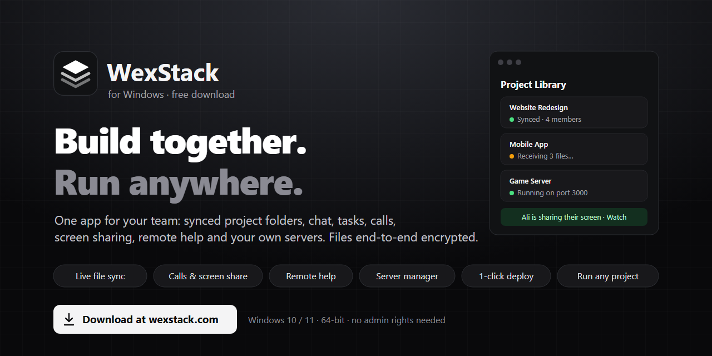
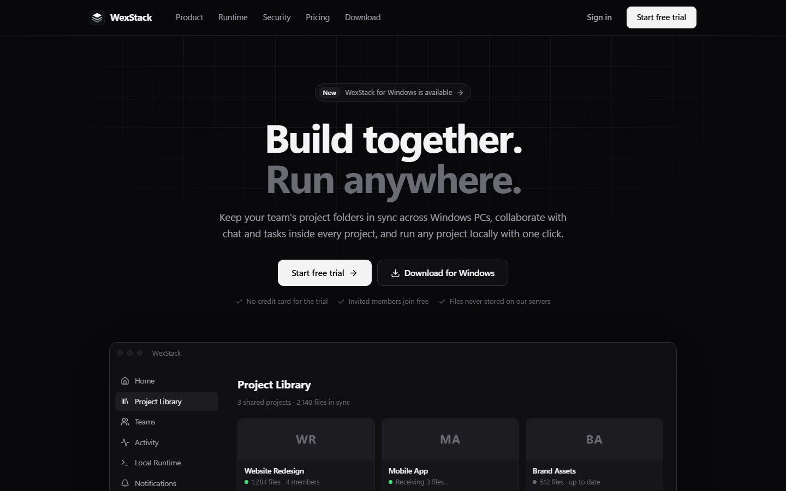
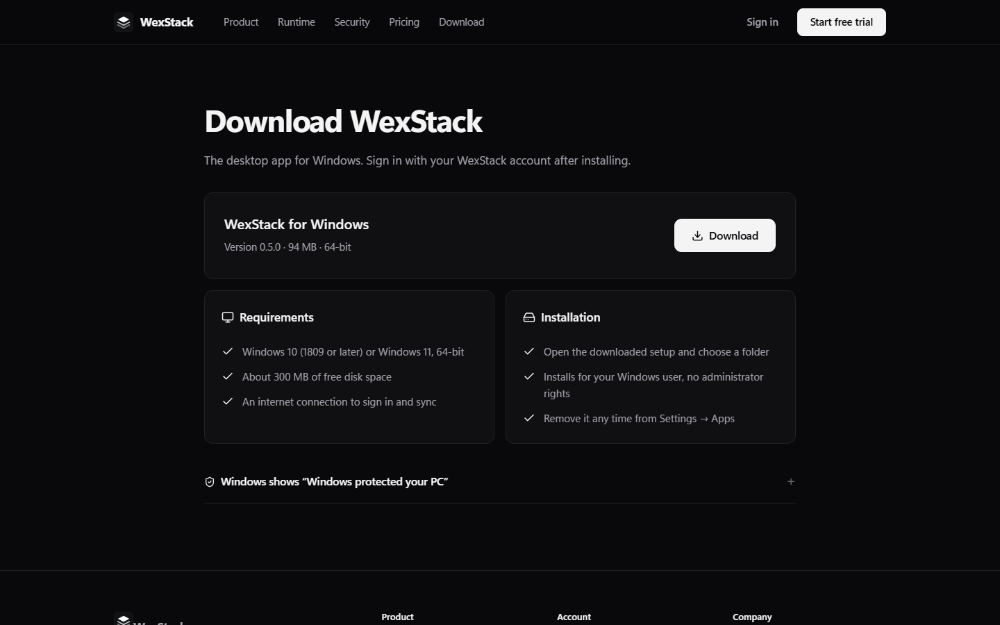
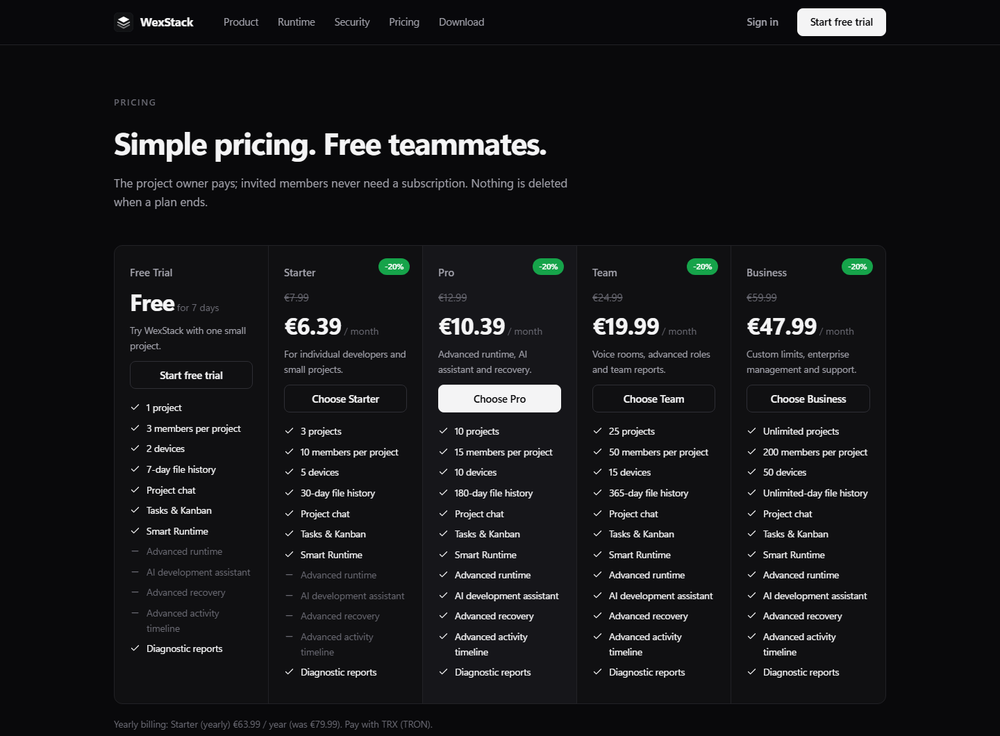

<p align="center">
  
</p>

<h1 align="center">WexStack for Windows</h1>

<p align="center">
  <b>Work on the same project from every PC on your team.</b><br>
  Synced project folders, chat, tasks, calls, screen sharing, remote help and your own servers — in one Windows app.
</p>

<p align="center">
  <a href="https://wexstack.com/download"><b>⬇ Download for Windows</b></a> ·
  <a href="https://github.com/wex-tech/WexStack/releases/latest">Releases</a> ·
  <a href="https://wexstack.com">Website</a> ·
  <a href="https://wexstack.com/pricing">Pricing</a> ·
  <a href="CHANGELOG.md">What's new</a> ·
  <a href="#türkçe">Türkçe</a>
</p>

<p align="center">
  
  
  
  
</p>

---

## What is WexStack?

WexStack keeps your team's project folders in sync across Windows PCs — Unity, Unreal, Visual Studio, VS Code or any
editor — and puts everything a small team needs around them: chat, a task board, voice calls, screen sharing, remote help,
a local runner that starts any project with one click, and a full manager for your own Linux servers.

Files travel **directly between your devices, end-to-end encrypted**. The WexStack service only coordinates; it never stores
your project files.

<p align="center">
  
</p>

## Download & install

**Easiest:** open **[wexstack.com/download](https://wexstack.com/download)** and press **Download**, then run `WexStack-Setup.exe`.
Or download it from GitHub: **[Latest release → WexStack-Setup.exe](https://github.com/wex-tech/WexStack/releases/latest/download/WexStack-Setup.exe)**.

**Command Prompt (cmd)** — download and start the installer:

```bat
curl -L -o "%TEMP%\WexStack-Setup.exe" https://wexstack.com/downloads/WexStack-Setup.exe && start "" "%TEMP%\WexStack-Setup.exe"
```

**PowerShell:**

```powershell
Invoke-WebRequest https://wexstack.com/downloads/WexStack-Setup.exe -OutFile "$env:TEMP\WexStack-Setup.exe"; Start-Process "$env:TEMP\WexStack-Setup.exe"
```

**Silent install** (no questions, default folder):

```bat
curl -L -o "%TEMP%\WexStack-Setup.exe" https://wexstack.com/downloads/WexStack-Setup.exe && "%TEMP%\WexStack-Setup.exe" /silent
```

**Check the file** (optional) — the SHA-256 must match `sha256` in
[the latest release info](https://apiser.wexstack.com/api/v1/releases/latest):

```bat
certutil -hashfile "%TEMP%\WexStack-Setup.exe" SHA256
```

| | |
|---|---|
| **Requirements** | Windows 10 (1809 or later) or Windows 11, 64-bit · about 300 MB free space · internet connection |
| **Installs for** | your Windows user only — no administrator rights |
| **Updates** | automatic: the app offers each new version and installs it in about a minute; your data is kept |
| **Uninstall** | Windows Settings → Apps → WexStack (your project files are never touched) |

> **"Windows protected your PC"?** New apps without a paid code-signing certificate get this SmartScreen notice.
> Click **More info → Run anyway**. The installer is the same file as on wexstack.com; you can compare its SHA-256 above.

<p align="center">
  
</p>

## Features

### 🔄 Project sync
- Live sync of the folders you choose (only those — WexStack never scans anything else on your PC).
- **Two people can edit the same file.** Saved changes are merged line by line: nothing is uploaded until you save,
  nobody's lines are lost, the same change is never duplicated, and line-ending differences are ignored.
  Only when two people change the very same line differently are both versions kept for you to choose.
- Conflicts never overwrite work: keep mine / keep theirs / keep both.
- Every version is kept in a local backup store on each PC; **restore points** for the whole project or chosen files, every
  restore can be undone.
- Immediate or interval publishing, pause/resume, bulk-delete guard, works offline and catches up.
- **Project trash:** a deleted project can be restored for 30 days — for every member.

### 💬 Team
- Project **chat** (reactions, pins, edit, "make a task from this"), **task board** (Kanban, assignees, due dates, comments).
- **Friends** and **private messages**.
- Roles (owner, manager, member, read-only), invitations, join by project ID with approval, audit log.

### 📞 Calls, screen sharing, remote help
- Voice calls in every project; join without a microphone to just watch and listen.
- **Screen sharing** with everyone in the project or **only the people you choose**.
- **Remote help:** let one chosen person use your mouse and keyboard — you see everything and can stop it any time.
- Audio and video go directly between you, encrypted.

### ▶️ Run any project
- Smart Runtime detects the project type (Node, .NET, Python, Go, Rust, static sites…), installs what it needs and starts it on a free port.
- **Run from GitHub:** paste a repository address — WexStack downloads it and runs it.
- **Problems** panel: compiler and runtime errors with file, line and a plain-language fix; "Check code" scans without running.
- Built-in PowerShell terminal in the project folder.

### 🖥️ Your servers (SSH)
- Terminal tabs, file manager with drag & drop and an editor, tunnels.
- **One-click deploy** of a project to your server, with a secret scan first.
- Domains with free HTTPS (Let's Encrypt), databases (PostgreSQL, MySQL, MariaDB, MongoDB, Redis).
- Live monitoring, a server assistant with one-click fixes, file and database backups.
- **Share server access** with a teammate without telling them a password.

### ✨ Everything else
- 20 interface languages (full Turkish), dark and light theme, Ctrl+K command palette.
- Quiet notification sounds (can be turned off), tray icon, start with Windows.
- Accounts with sessions and device management; payments by crypto (TRX).

## Plans

Registering is free and **invited team members never pay**. Start with a free trial; one owner pays for the team.
Calls, screen sharing and remote help are part of the Team plan. See **[wexstack.com/pricing](https://wexstack.com/pricing)**.

<p align="center">
  
</p>

## What's new

| Version | Highlights |
|---|---|
| **0.5.0** | Project trash (30 days), private messages, remote help, smarter same-file merge, notification sounds |
| **0.4.1** | Notices fade out by themselves |
| **0.4.0** | Delete a project for everyone, friends, screen sharing with chosen people, watch without a microphone |
| **0.3.8 – 0.3.9** | 20 languages, compact Problems panel, Ctrl+K command palette |
| **0.3.3 – 0.3.7** | Calls & screen sharing, server monitoring and backups, project terminal, Run from GitHub |
| **0.3.0 – 0.3.2** | Servers: SSH terminal, files, deploy, domains, databases, password-free sharing |
| **0.2.0** | Restore points |
| **0.1.x** | Sync, teams, chat, tasks, Smart Runtime, automatic updates, Problems detection |

Full list: **[CHANGELOG.md](CHANGELOG.md)**

## Privacy & security

- Project files go **device to device**, end-to-end encrypted (AES-256-GCM); the service stores only encrypted metadata.
- Only folders you add are ever read or shared. Removing a member ends their access immediately and rotates the project keys.
- Remote control works only while you allow it, only for the one person you chose, and never reaches admin windows or
  the Windows sign-in / UAC screens.

## Support

Questions, bugs and ideas: open an **[issue](../../issues)** or visit **[wexstack.com](https://wexstack.com)**.

---

<a id="türkçe"></a>

## Türkçe

**WexStack**, ekibinin proje klasörlerini tüm Windows bilgisayarlarda senkronize tutan, yanına sohbet, görev panosu,
sesli arama, ekran paylaşımı, uzaktan yardım, tek tıkla proje çalıştırma ve kendi sunucularını yönetme ekleyen bir masaüstü uygulamasıdır.
Dosyalar sunucuda saklanmaz; cihazlar arasında doğrudan ve uçtan uca şifreli gider.

**İndir:** [wexstack.com/download](https://wexstack.com/download)

**CMD ile indir ve kur:**

```bat
curl -L -o "%TEMP%\WexStack-Setup.exe" https://wexstack.com/downloads/WexStack-Setup.exe && start "" "%TEMP%\WexStack-Setup.exe"
```

**Öne çıkanlar**
- Aynı dosyayı iki kişi düzenleyebilir: kaydedince değişiklikler satır satır birleşir, kimsenin yazdığı silinmez, kod çift olmaz.
- Proje çöp kutusu: silinen proje 30 gün içinde herkes için geri gelir.
- Arama ve ekran paylaşımı: projedeki herkesle ya da sadece seçtiğin kişilerle. Mikrofonsuz izleme.
- Uzaktan yardım: seçtiğin tek bir kişi fareni ve klavyeni kullanabilir; istediğin an durdurursun.
- Arkadaşlar ve özel mesajlar.
- Herhangi bir projeyi tek tıkla çalıştır, GitHub'dan indirip çalıştır, hataları dosya ve satırıyla gör.
- Sunucular: terminal, dosyalar, tek tıkla yayınlama, alan adı + HTTPS, veritabanı, izleme, yedekleme, şifresiz erişim paylaşımı.
- 20 dil (tam Türkçe), açık/koyu tema, otomatik güncelleme, kısık bildirim sesleri.

> "Windows bilgisayarınızı korudu" uyarısı çıkarsa **Ek bilgi → Yine de çalıştır**'a bas. Uygulama ücretli imza sertifikası
> olmadığı için bu uyarıyı alıyor; dosyanın SHA-256 değerini yukarıdaki komutla kontrol edebilirsin.

---

<p align="center"><sub>© WexStack. All rights reserved. This repository contains the public download page, release notes and images; the application source code is not published here.</sub></p>
